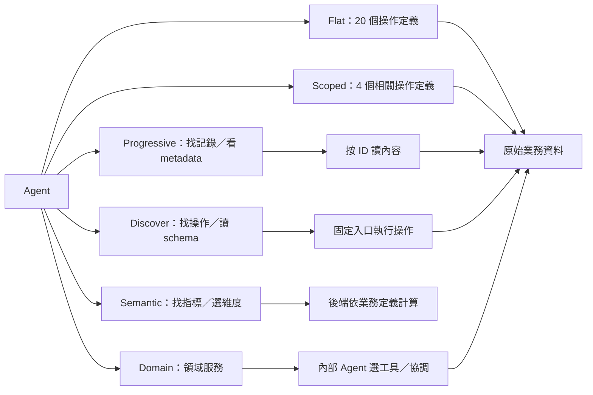

# MCP Server 設計差異與 Langfuse 實測審閱

公開版保留合成資料的觀察與數值；私人追蹤連結及原始 observations 未納入 repository。下文為既有實驗紀錄，不代表本次發布重新執行了遠端驗證。

以下保留第一輪審閱。第二版已精簡 Progressive 中繼資料並重新執行，最新結果見[責任邊界示範 v2](experiment-review-v2.md)。

本次只讀回 batch `20261016T083212Z-f5cc0e0a` 的既有追蹤，沒有重新呼叫模型或修改 Server 行為。

結論：六組在協定執行、答案及計帳上正常，五種介面差異也確實進入模型。現有案例可以展示操作過程，但還不足以展示每個 Pattern 的效益；Progressive 的 metadata 設計尤其需要調整。不能從目前 token 排序推論 Pattern 優劣。

## 1. 設計差異在哪裡

各 Server 共用 FastMCP／stdio、資料及業務函式。差異在「模型一開始能看見什麼、如何取得資料或能力、誰負責計算及協調」。Server 入口檔案很短，是因為它們負責註冊介面，行為實作則共用；不同資料夾不代表需要複製不同業務後端。

| 組別 | 改變的責任／資訊邊界 | 核心實作 | 本版的範圍 |
| --- | --- | --- | --- |
| Flat | 完整操作定義預載，模型選操作與計算 | [flat/server.py](../src/mcp_pattern_demo/servers/flat/server.py) | 基準組 |
| Scoped | 註冊時限縮可見能力；計算仍由模型完成 | [scoped/server.py](../src/mcp_pattern_demo/servers/scoped/server.py) | 靜態 sales_case 白名單，未示範角色／租戶授權 |
| Progressive | 把記錄索引、metadata、完整內容分開提供 | [backend.py 的 search_records／get_metadata／get_content](../src/mcp_pattern_demo/backend.py) | 資料探索，工具清單本身仍固定 |
| Discover | 操作規格改為按需取得，再由固定入口派送 | [registry.py 的 search_tools／get_tool_schema／call_tool](../src/mcp_pattern_demo/registry.py) | 操作探索，沒有 Code Mode 或動態新增外層工具 |
| Semantic | 業務公式與彙總計算由後端負責 | [backend.py 的 METRICS／query_metrics](../src/mcp_pattern_demo/backend.py) | 模型挑指標、期間與維度，客服仍回查原文 |
| Domain | 工具選擇與協調移到內部 Agent | [domain/server.py](../src/mcp_pattern_demo/servers/domain/server.py) | 真實內部 Agent，用同一模型及 4 支核心工具；未加入額外專家知識 |

Scoped 改的是「提供哪些操作」，Progressive 改的是「何時提供哪些資料」，Discover 改的是「何時取得哪些操作規格」，Semantic 改的是「誰持有業務計算口徑」，Domain 改的是「誰做領域內協調」。這些是不同的設計軸。

## 2. 從 Langfuse 重新核對了什麼

讀取了七條 trace（六個外層樣本加 Domain inner），含模型與工具 I/O、模型實際工具定義、狀態、usage、metadata。

- 40 個唯一 OpenAI response 全部 completed；error 與 incomplete_details 為空。
- 七條 trace 沒有 ERROR／WARNING；所有工具回傳的業務 envelope 都是 status=ok。
- 實際模型請求中的工具名稱清單，逐回合都與保存的 visible_tools 相符。
- 逐筆核對 Langfuse generation buckets、OpenAI response usage、SDK usage，一致；沒有重複的 response ID。
- 沒有參數完全相同的重複工具呼叫，未見失敗後的重試迴圈。
- 最終引用 ID 都曾在對應層的工具回傳中出現；Domain 外層的原始資料查詢可追至 inner。
- 六組數值均為淨營收 61,500 元、O02 退款 5,000 元；原因可由 N02a／N02b 支持。

上述支持「執行、答案、計帳正常」，不等於「介面已最佳化」或「Pattern 效益已被證明」。引用 ID 存在也不是完整的通用 prose grounding 驗證器；本題另有逐項對照來源。

## 3. 每一組的實際路徑與判斷

| 組別／trace | 實際工具路徑 | 首輪 input | 總 token | 判斷 |
| --- | --- | --- | --- | --- |
| Flat | payments → refunds → case_notes | 1,136 | 8,412 | 正常，選對所需工具 |
| Scoped | payments → refunds → order → case_notes | 755 | 9,458 | 首輪較小，但多查訂單／多一個模型回合 |
| Progressive | search ×2 → metadata → content → search → metadata → content | 751 | 22,626 | 路徑正常，metadata 過重且沒有少讀 |
| Discover | search → schema ×2 → call ×2 → schema → call | 683 | 16,052 | 按需探索成立；搜尋有噪音、往返增加 |
| Semantic | metrics → dimensions ×2 → query ×2 → order → notes | 770 | 11,695 | 後端公式確實執行；探索有重複資訊 |
| Domain outer | analyze_sales_case | 602 | 2,148 | 委派與呈現 |
| Domain inner | payments → refunds → order → notes | 866 | 9,447 | 真實查詢與彙整；內外合計 11,595 |

首輪 input 是整個請求的實際用量，包含指令、工具定義與輸出要求，不是單獨的 schema token。各 Pattern 有一小段不同的介面引導，數字不能當作完全隔離工具定義的因果估計。

### Scoped：有減少初始負擔，但沒有保證總量減少

模型實際收到的工具定義是 20 支對 4 支，首輪 input 為 1,136 對 755。兩組的 payments／refunds／notes 呼叫參數及回傳資料相同；Scoped 額外呼叫 get_order(O02)，因此多一個模型回合。總量較高可由這條路徑解釋，不是工具集合限縮失效，也不能從一次多查就推論穩定退步。

### Progressive：目前最需要調整的示範設計

Agent 找到 7 筆付款、6 筆退款，取得這 13 筆的 metadata，隨後把完全相同的 13 筆完整內容都讀回。找客服時也先取兩筆 metadata，再把兩筆內容都取回。

更明確的問題是 metadata 在每筆記錄重複 content_fields 等結構資訊。對同一批 13 筆資料：

- Langfuse 記錄的工具 output 字串：metadata **4,234 字元**，完整內容 **2,769 字元**。
- 剝除 MCP text 包裝、以相同 JSON 方式序列化：metadata **2,401 字元**，完整內容 **1,768 字元**。

這是字元長度，不是 token。兩種口徑都顯示 metadata 比原始小型記錄大，且此次沒有減少完整內容讀取量。get_content 後的 input 又持續帶著先前的搜尋與 metadata，最後一輪 input 為 4,414。

因此可將本次結果描述為「全量彙總任務中的逐層探索成本」。不能用它代表 Figma／文件型 Progressive 的一般效果。優先改善方式是共用一次 record schema、縮小索引、避免每筆重複欄位清單；但全量金額彙總依然需要所有符合條件的數值，並不因 metadata 縮小就保證節省。

### Discover：能力探索是真的，搜尋品質只是簡易 Mock

初始模型只有三個固定入口。search_tools 回傳八個候選，前四個是客服、訂單、付款、退款；另外包含 inventory、campaign、coupon 等無關操作。Agent 正確選擇三份 schema，然後以 operation_id／arguments 執行 payments、refunds、notes，並未誤用那些候選。

這支持「規格按需取得」，但 substring 比對會被泛用字詞影響，搜尋品質仍弱。20 支工具規格本來就小，省下的初始量在本次不足以抵銷額外往返。這也不是 Cloudflare Code Mode；模型沒有寫組合程式或在 Server 端保留分頁中間資料。

### Semantic：差別在公式與資料回傳層級

原始工具提供 amount_minor、status、日期等記錄；Semantic 的 query_metrics(net_revenue) 直接回傳 amount_minor=6150000 及來源 ID，另一個 query_metrics(refunded_amount, group_by=order_id) 回傳各訂單成功退款合計。數值計算已移到後端，模型仍需選正確期間／維度，並讀客服原文。

list_metrics 已帶 dimensions，之後 get_dimensions 兩次有資訊重複；這是可精簡的介面重疊，並非執行錯誤。本題又把正確公式提供給所有組，不能用全組答對來宣稱 Semantic 已證明降低口徑錯誤。

### Domain：責任真的移到內層，但尚無專家能力差異

外層把期間、區域、成功狀態與問題一起交給 analyze_sales_case。內層 Agent 查原始資料、彙整並引用客服；外層再呈現。內外兩條 trace 已分別核對，總量 11,595，不把外層 2,148 當作系統總量。

內層沿用同一模型、共同業務規則與 Scoped 四支工具，所以目前驗證的是委派邊界與成本，不是額外專業知識、特殊治理或更強推理的價值。

## 4. 正常結果的解讀邊界與優先改進

目前固定 parallel_tool_calls=False，每次工具往返都會增加模型回合；例如 Discover 本次七次工具呼叫對應八次模型請求。這是當前 Host 設定下的行為，不能說是 Pattern 的必要回合數或性能下限。

累計 token 包含重送歷史及 cached input；本次沒有用單價比較實付成本。Langfuse bucket 與 SDK 用量經逐筆對帳，數字本身可信，仍不能將單次總 token 排名解讀為選型排名。

建議維持小型示範，按下列順序改善：

1. 先以本文件的資料／責任流說明差異，閱讀入口檔之外，也指出 backend／registry 的實作位置。
2. 優先精簡 Progressive metadata，將同批 IDs 是否少讀、metadata 是否真的較小列為示範檢查。
3. 改善 Discover 泛用字詞命中與 Semantic 重複維度資訊；保留本批結果，不覆蓋第一輪觀察。
4. Domain 保留為委派示範，文章明確列內外成本與沒有額外專家知識的範圍。

本次未修改上述行為或重新執行模型。原始 observations、逐筆對帳、實際參數與解析後回傳保存於本機 artifacts 的 trace-audit 目錄，便於與 Langfuse 交叉檢查。
